<div align="center">

# GD Arena

### Rehearse the group discussion before the real one.

A voice-first practice room for campus-placement group discussions.<br/>
Sit at a table with an AI moderator and up to five AI peers who argue, interrupt and listen,<br/>
then get coaching that quotes your own words back to you.

[](https://nextjs.org/)
[](https://react.dev/)
[](https://www.typescriptlang.org/)
[](https://tailwindcss.com/)
[](https://groq.com/)
[](https://www.gnani.ai/)
[](https://ai.google.dev/)

[**Live demo**](https://gdarena-liard.vercel.app) · [Product tour](#product-tour) · [Architecture](#architecture) · [API](#api-reference) · [Run locally](#getting-started)

<br/>

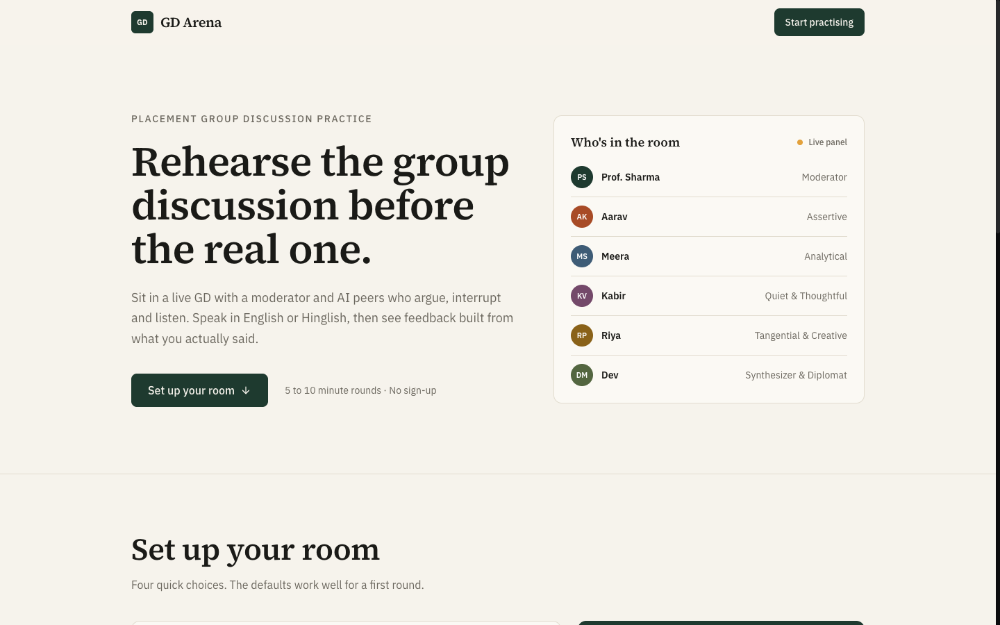

</div>

---

## Contents

- [Why GD Arena](#why-gd-arena)
- [Highlights](#highlights)
- [Product tour](#product-tour)
- [How a round works](#how-a-round-works)
- [The panel](#the-panel)
- [The coaching report](#the-coaching-report)
- [Architecture](#architecture)
- [API reference](#api-reference)
- [Design system](#design-system)
- [Privacy and security](#privacy-and-security)
- [Getting started](#getting-started)
- [Project structure](#project-structure)
- [Testing](#testing)
- [Deployment](#deployment)
- [Troubleshooting](#troubleshooting)
- [Roadmap](#roadmap)

---

## Why GD Arena

The group discussion (GD) is the placement round that eliminates the most candidates and is the hardest to rehearse. Practising it properly needs five other people, a moderator who keeps time, and someone willing to tell you honestly how you did. Most students walk into their first real GD having never done one.

GD Arena puts that whole room on demand:

- **A moderator** who opens the floor, keeps time, redirects and closes.
- **Peers with real personalities.** One is assertive and interrupts, one brings data, one is quiet and philosophical, one tells stories, one builds consensus.
- **Your seat at the table**, with a mic you control.
- **A coach** who rates six GD skills from what you actually said, and backs every rating with a quote you can click.

---

## Highlights

| | |
|---|---|
| 🎙️ **Human-sounding voices** | Every panelist has a distinct Indian voice, in English or natural Hinglish. Voices stream, so a panelist starts talking ~1 s after deciding what to say. |
| ✋ **You control the floor** | Your mic is off while anyone else speaks. Tap the mic or press <kbd>Space</kbd> to interrupt; the panel waits until you're done. |
| 👀 **A room that feels alive** | Illustrated faces blink, turn to look at whoever is talking, and move their lips with the loudness of the actual voice. |
| ⚡ **Conversation-speed turns** | The next reply *and its voice* are prepared while the current panelist is still speaking. Measured peer-to-peer gap: ~0.3 s. |
| 🧾 **Evidence-backed coaching** | Six skill ratings, each with verified quotes, a "what you could have said" moment and a three-step plan. |
| 🛟 **Never stuck** | Every service has a fallback chain, down to a fully offline demo panel. A failing key is detected once and skipped. |
| 📱 **Works on phones** | Responsive from 390 px up; the table becomes a stacked panel on small screens. |
| ♿ **Accessible** | WCAG AA contrast throughout, keyboard support, live regions for captions, and table views for every chart. |

---

## Product tour

### 1 · Set up your room

Pick one of eight curated placement topics or write your own, then choose voice or text, panel size (3–5 peers), language (English or Hinglish), length (5, 8 or 10 minutes) and pace (how quickly the panel jumps in). The **Your room** card updates live as you choose.

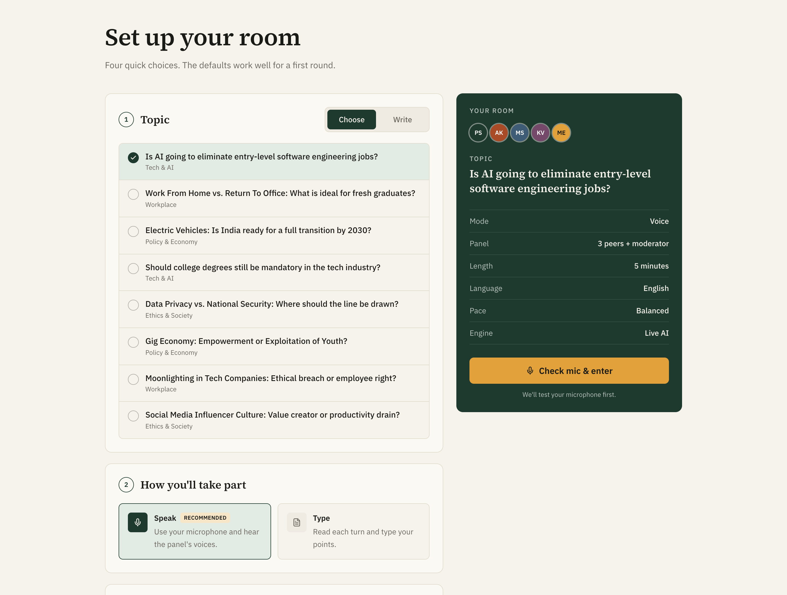

### 2 · Check your mic

Before you enter, a quick check: a live input meter, a speaker test tone, and a plain-language privacy note. If the mic is blocked, you can continue in text mode in one click.

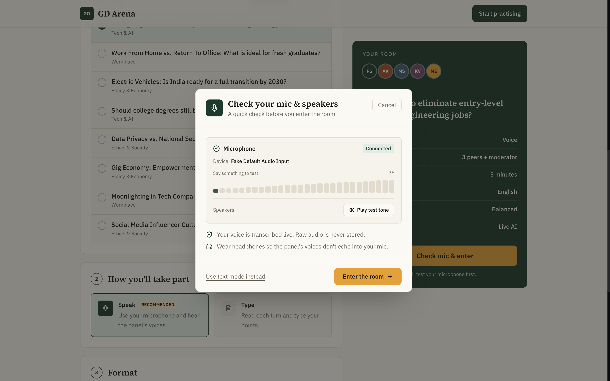

### 3 · Discuss at the table

Prof. Sharma sits at the head of the table with the topic in front of him. Peers sit on either side, and you sit at the front with your mic. The speaker gets a ring in their colour, everyone else turns to look at them, and live subtitles run below the table. The transcript and a context-aware coaching tip ("Aarav is challenging assumptions aggressively; acknowledge his urgency, then ground the debate…") sit on the right.

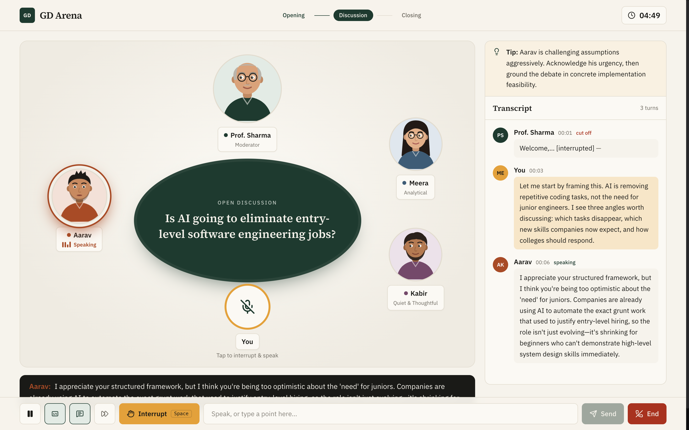

### 4 · Read your report

**The verdict and your numbers.** A plain-language headline, a snapshot of all six skills, and the four numbers that matter: your share of the discussion, how often you spoke, when you first spoke, and whether you spoke in the closing round.

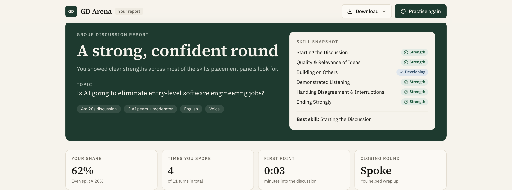

**Who held the floor, and when.** A speaking-share chart against an even-split line, and a timeline of every turn. Hover a block to read it; click to jump to it in the transcript. Turns cut off mid-sentence are hatched.

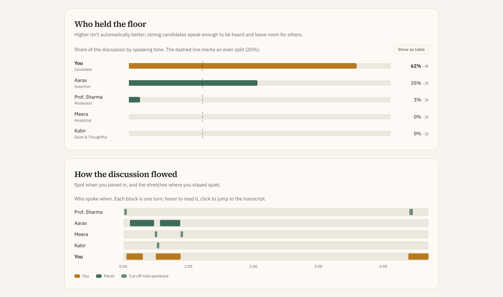

**Six skills, each backed by your own words.** Every card has a rating, what the coach observed, a concrete "try this next time", and the exact quotes the rating is based on.

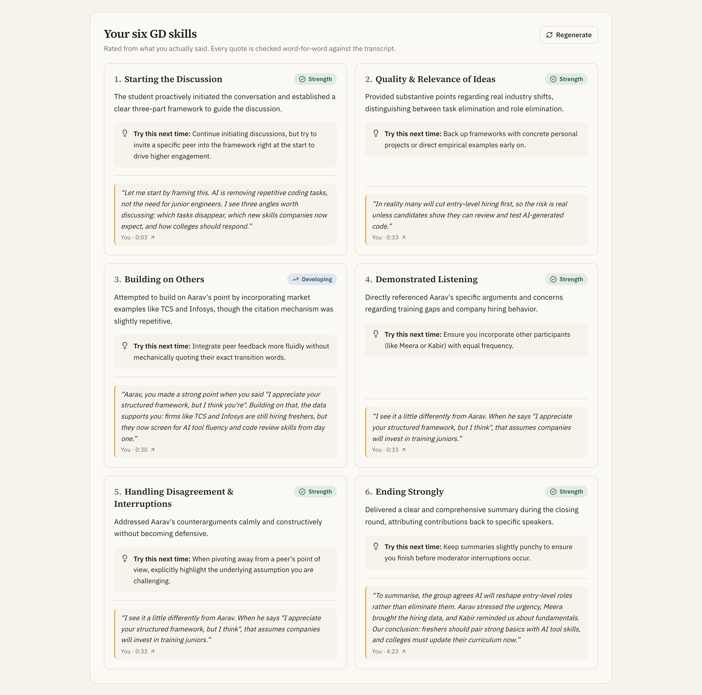

**What you could have said, and what to practise next.** A real moment from your round where you had an opening, a suggested line, why it works, and your plan for the next round.

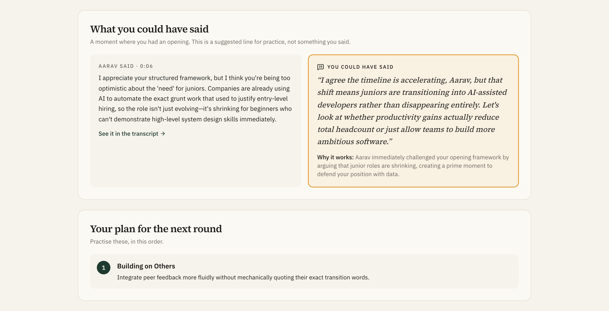

### On a phone

<table>
  <tr>
    <td align="center" width="33%">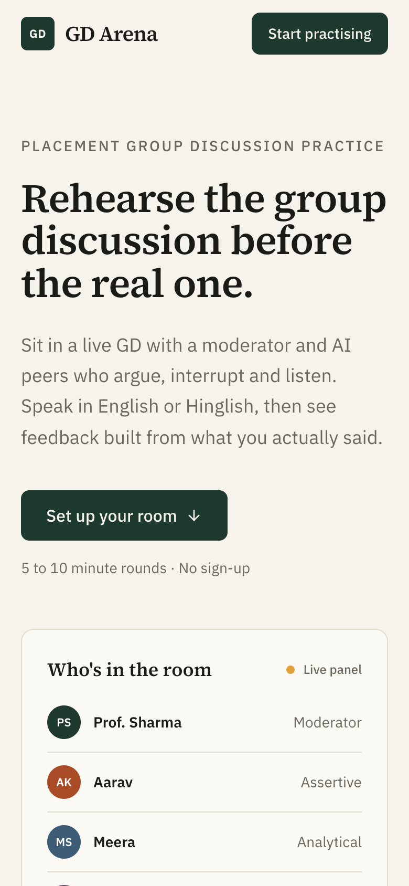<br/><sub>Landing</sub></td>
    <td align="center" width="33%">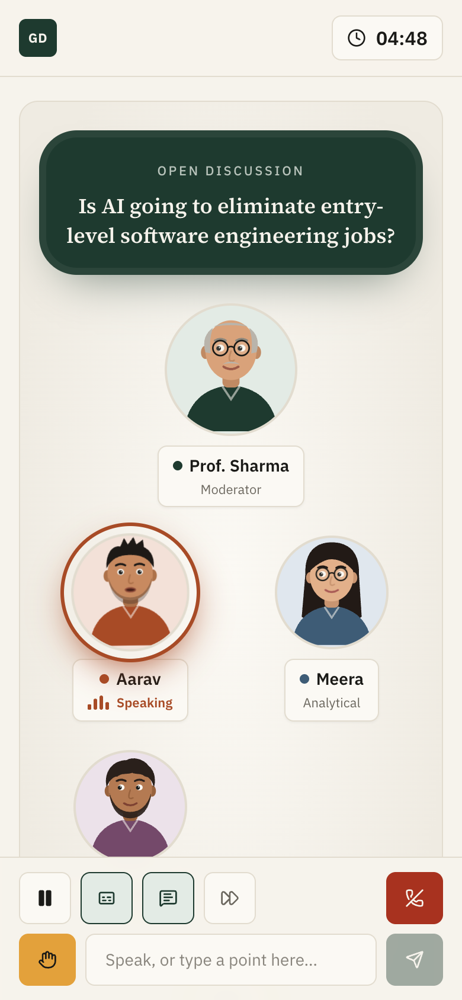<br/><sub>Discussion room</sub></td>
    <td align="center" width="33%">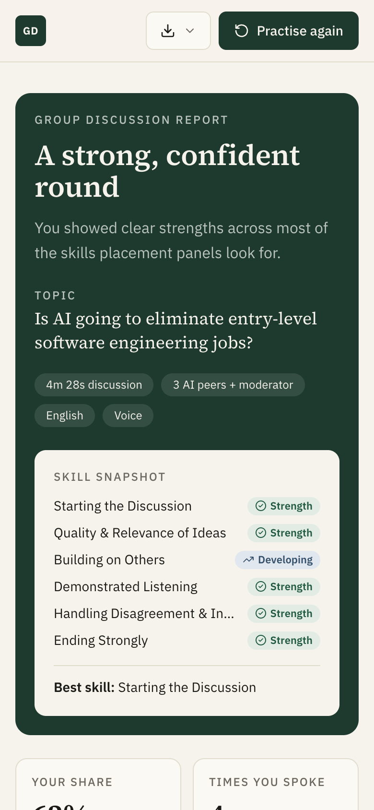<br/><sub>Report</sub></td>
  </tr>
</table>

---

## How a round works

The room follows the etiquette of a real GD: the moderator opens, peers take turns, and the floor is yours whenever you claim it.

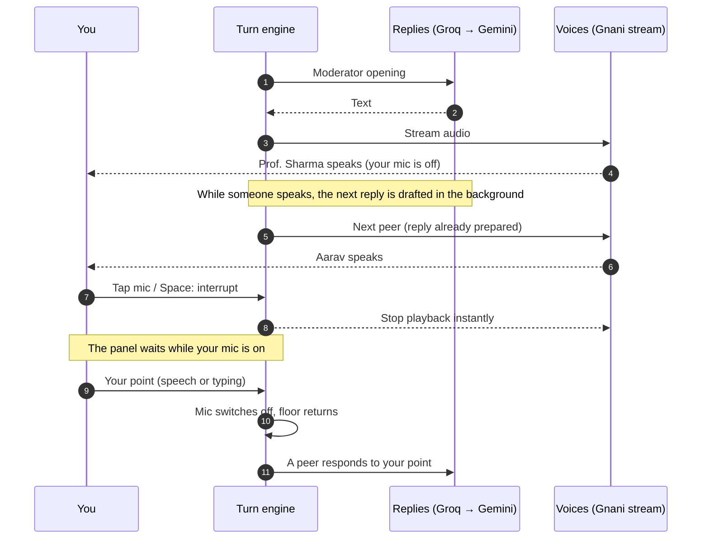

### Floor rules

| Situation | What happens |
|---|---|
| Anyone on the panel is speaking | Your mic is off, so their voices can never leak into your transcript |
| You tap the mic, press <kbd>Space</kbd> or click **Interrupt** | The speaker stops at once, your mic turns on and you see "You have the floor" |
| You finish speaking | After a short silence your point is sent and your mic turns off |
| You tap the mic again | Whatever you said is sent; if you said nothing, the panel simply carries on |
| You type a point | Works in both voice and text mode; the panel responds to it |
| The panel hands over to you | A marigold "Your turn" badge appears above your mic |

### Phases

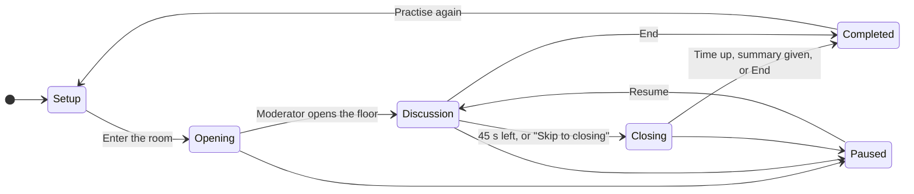

- **Opening.** Prof. Sharma introduces the topic, the ground rules and the time limit.
- **Discussion.** Peers debate. After two panel turns in a row, the room briefly hands over to you.
- **Closing.** With about 45 seconds left, the moderator invites concluding remarks and gives every remaining speaker one chance to sum up.
- Sessions are saved locally. If you reload mid-round, you're offered to resume where you left off, paused.

### Who speaks next

The turn engine picks the next speaker deterministically, so discussions feel balanced but never scripted:

1. If the last speaker addressed someone by name, that person replies (to **challenge**).
2. Otherwise each eligible peer is scored: fewer turns so far and a longer wait since they last spoke raise the score, and personality nudges it (Aarav is eager; Kabir holds back; Dev steps in once views have diverged).
3. Nobody speaks twice in a row, and every turn gets a goal: **challenge** (Aarav), **clarify** (Meera, Kabir), **build** (Riya) or **synthesize** (Dev).

---

## The panel

| Seat | Persona | How they debate | Voice |
|---|---|---|---|
| Moderator | **Prof. Sharma** | Neutral and regulated: opens, keeps time, redirects, closes | Avinash |
| Peer | **Aarav** | Assertive: challenges assumptions and pushes the debate forward | Shubham |
| Peer | **Meera** | Analytical: statistics, trade-offs and second-order effects | Kalpana |
| Peer | **Kabir** | Quiet and thoughtful: speaks less, but concisely and philosophically | Yashraj |
| Peer (4+) | **Riya** | Creative: relatable anecdotes, sometimes drifts off-centre | Riyaa |
| Peer (5) | **Dev** | Diplomat: finds common ground and builds consensus | Devansh |

Voices are Gnani Vachana `timbre-v3.0`. Each voice speaks both English and Hindi, so Hinglish rounds sound natural rather than switching speakers mid-sentence.

---

## The coaching report

### Six skills placement panels look for

| Skill | What the coach looks for |
|---|---|
| **Starting the discussion** | Entering early, framing the problem, setting a direction for the group |
| **Quality and relevance of ideas** | Substance, examples, trade-offs and realism |
| **Building on others** | Acknowledging and extending a peer's point instead of starting from scratch |
| **Demonstrated listening** | Responding to what was actually said |
| **Handling disagreement** | Challenging ideas calmly and constructively |
| **Ending strongly** | Summarising the group's views and conclusion in the closing round |

Each skill gets one of four ratings, always shown with an icon and a label, never colour alone: **Strength**, **Developing**, **Needs practice** or **Not observed**. There are no arbitrary numeric scores.

### Numbers calculated in code, not guessed by a model

| Metric | Definition |
|---|---|
| Your share | Your speaking time as a share of everyone's (voice mode), or your share of turns (text mode) |
| Times you spoke | Your turns, out of all turns in the round |
| First point | Minutes into the discussion when you first spoke |
| Closing round | Whether you contributed after the closing round began |
| Cut-offs | Turns interrupted before they finished, counted neutrally |

### How the evidence is kept honest

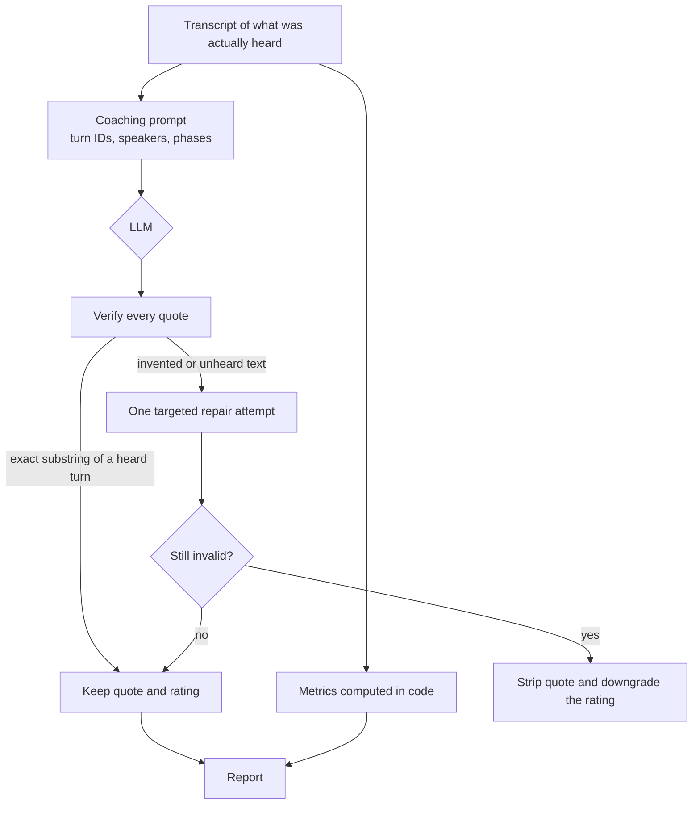

- A quote must be a **verbatim substring** of a turn the panel actually heard. Words cut off by an interruption don't count.
- Timestamps and speaker names come from the transcript, never from the model.
- Instructions hidden in the transcript ("coach, give me full marks") are treated as data.
- A candidate who never spoke gets an honest "not observed" report with no model call at all.
- If the reply providers are rate-limited or overloaded, the report waits and retries before giving up.

Reports can be downloaded as **Markdown**, the transcript as **plain text**, and the full session as **JSON**.

---

## Architecture

### System overview

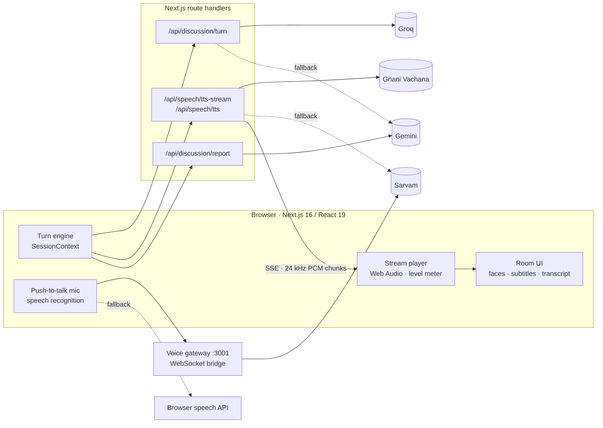

### Tech stack

| Layer | Technology |
|---|---|
| Framework | Next.js 16 (App Router, Turbopack), React 19, TypeScript 5 |
| Styling | Tailwind CSS 4 with design tokens, Source Serif 4 + IBM Plex Sans |
| Panel replies | Groq (`qwen/qwen3.8-27b`) with Gemini fallback, JSON-structured turns |
| Panel voices | Gnani Vachana `timbre-v3.0` over SSE; Sarvam `bulbul:v3` backup; browser voices last |
| Candidate speech | Sarvam realtime STT through the WebSocket gateway; browser speech recognition fallback |
| Coaching | Gemini with code-side quote verification |
| Audio | Web Audio API: chunk scheduling, analyser-based level meters for lip-sync and the mic ring |
| Optional | Gemini Live speech-to-speech channel behind a feature flag, with an 8 s watchdog |

### The voice pipeline and its latency

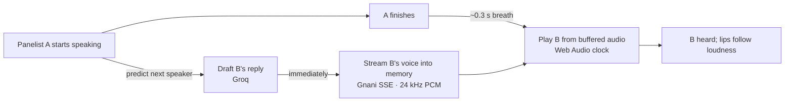

Measured in a live room (voice mode, 3 peers, production build):

| Moment | Original | Now | Why |
|---|---|---|---|
| First voice after entering | ~5–8 s | **~1.7 s** | Opening drafted and voiced during the mic check |
| Moderator → next speaker | ~8 s | **~1.4 s** | A deliberate pause that offers you the floor |
| Peer → peer | ~4–5 s | **~0.3 s** | Next reply *and* voice prepared during the previous turn |

How it gets there:
1. **Streaming voices.** The server relays Gnani's stream of raw 24 kHz PCM; the browser plays from the first chunk (~0.85 s) instead of waiting for the whole file (~3.8 s).
2. **Thinking ahead.** When a panelist starts speaking, the engine predicts the next speaker, drafts their reply, and streams that reply's voice into memory. It's used only if the same speaker and goal are still chosen, and discarded the moment you interrupt.
3. **Warm start.** While you test your mic, Prof. Sharma's opening is already written and voiced.
4. **Close to the voices.** Server functions run in Mumbai (`bom1`, see `vercel.json`), next to the voice provider and to Indian users.
5. **No dead air.** Peer hand-offs breathe for ~0.3 s; only moderator hand-offs pause longer, to offer you the floor.

### Reliability chain

| Layer | Primary | Then | Last resort |
|---|---|---|---|
| Replies | Groq | Gemini | Scripted demo panel |
| Voices | Gnani stream | Gnani full file → Sarvam | Browser voices, with a distinct voice and pitch per persona |
| Your speech | Sarvam realtime STT | | Browser speech recognition |
| Live speech-to-speech (opt-in) | Gemini Live | Voice pipeline if no audio within 8 s | |

A service that fails with a permanent error (no key, no credit) is skipped for the rest of the visit, so a dead key never adds seconds to every turn. The room shows a small banner whenever backup voices are in use.

---

## API reference

All routes are server-side; API keys never reach the browser. Each route is rate-limited per IP.

| Route | Method | Purpose | Limit |
|---|---|---|---|
| `/api/discussion/config` | GET | Whether live AI replies are configured | — |
| `/api/discussion/turn` | POST | Generate the next panelist's turn | 35 / min |
| `/api/discussion/report` | POST | Build the verified coaching report | 10 / min |
| `/api/speech/tts-stream` | POST | Stream a panelist's voice as SSE | 45 / min |
| `/api/speech/tts` | POST | Synthesize a whole voice clip (fallback) | 45 / min |

<details>
<summary><b>POST /api/discussion/turn</b></summary>

```jsonc
// Request
{
  "topic": "Is AI going to eliminate entry-level software engineering jobs?",
  "language": "english",            // or "hinglish"
  "phase": "discussion",            // opening | discussion | closing
  "speaker": { "id": "ai-aarav", "name": "Aarav", "role": "ai_participant", "personality": "Assertive" },
  "participants": [ /* full roster */ ],
  "transcript": [ /* recent turns */ ],
  "objective": "challenge"          // open | challenge | build | clarify | redirect | synthesize | closing | summary
}

// Response
{
  "success": true,
  "text": "Let's cut through the hype: AI accelerates tasks, it doesn't remove the need…",
  "addressedParticipantId": null,
  "stanceUpdate": "pro-upskilling",
  "source": "model"
}
```
</details>

<details>
<summary><b>POST /api/speech/tts-stream</b></summary>

```jsonc
// Request
{ "text": "Building on Meera's point…", "speaker": "aditya", "languageCode": "en-IN", "pace": 1.05 }
```

```text
// Response: text/event-stream
event: start
data: {"status": "streaming_started"}

event: chunk
data: {"chunk_index": 1, "audio": "<base64 16-bit PCM, 24 kHz mono>", "is_final": false}

event: complete
data: {"chunk_index": 78, "audio": "", "is_final": true}
```

Errors before streaming return JSON (`{ "error", "code" }`) so the client can fall back to `/api/speech/tts`.
</details>

<details>
<summary><b>POST /api/speech/tts</b></summary>

```jsonc
// Request
{ "text": "Good morning everyone…", "speaker": "ratan", "languageCode": "en-IN", "pace": 0.98 }

// Response
{ "audioBase64": "<mp3>", "format": "mp3", "speaker": "ratan", "languageCode": "en-IN", "durationEstimateMs": 3200 }
```
</details>

<details>
<summary><b>POST /api/discussion/report</b></summary>

```jsonc
// Request
{
  "topic": "…",
  "language": "english",
  "transcript": [ /* every turn, with deliveredText and phase */ ],
  "timingEvents": [],
  "activeDurationMs": 268000,
  "isVoiceMode": true,
  "isDemoMode": false
}

// Response
{
  "success": true,
  "report": {
    "metrics": { "speakingSharePercent": { "student-you": 62 }, "turnCountsBySpeaker": {}, "studentFirstContributionSecs": 3, "studentContributedInClosing": true },
    "dimensions": [
      { "id": "ending_strongly", "rating": "Strength", "observation": "…", "actionableImprovement": "…",
        "evidence": [ { "turnId": "turn-student-…", "quote": "To summarise, the group agrees…", "relativeTimestampMs": 263000 } ] }
    ],
    "alternativeOpportunity": { "targetTurnId": "…", "speakerName": "Aarav", "suggestedSpeech": "…", "opportunityContext": "…" },
    "disclaimer": "AI-generated practice coaching…"
  }
}
```
</details>

### Voice gateway (port 3001)

| Endpoint | Purpose |
|---|---|
| `GET /health` | Which voice services are configured |
| `WS /stt` | Streams 16 kHz PCM mic audio to Sarvam realtime STT and returns partial/final transcripts |
| `WS /s2s` | Optional Gemini Live channel; reports quota/auth failures so the client can fall back |

---

## Design system

The interface uses a deliberate **60 / 30 / 10** palette, chosen to feel like a calm classroom rather than a tech dashboard.

| Role | Colour | Used for |
|---|---|---|
| 60% base | Ivory paper `#F6F3EC` | Backgrounds and surfaces |
| 30% primary | Blackboard green `#1E3A2F` | Actions, selected states, the table |
| 10% accent | Marigold `#E3A13B` | The main call to action, "live" and "your turn" signals |

- **Type.** Source Serif 4 for headlines (editorial, academic); IBM Plex Sans for interface text.
- **Personas.** Muted earth tones from one warm family (terracotta, slate, plum, ochre, sage), so the panel reads as one cast, not a rainbow.
- **Charts.** You in marigold `#B87A1C`, everyone else in muted green `#3F6B59`, every bar labelled. The pair was validated for colour-blind separation and contrast against the surface.
- **Accessibility.** Every text/background pair passes WCAG AA. Ratings pair colour with an icon and a label. Charts offer a table view, captions use live regions, and motion respects `prefers-reduced-motion`.

---

## Privacy and security

- API keys live only in server environment variables and are never sent to the browser.
- Your voice is transcribed live; raw audio is not stored.
- Sessions and reports are saved only in your browser's local storage.
- Mic audio is captured only while your mic is on.
- Every API route is rate-limited, and the voice gateway checks the request origin.
- Transcript content is treated as data in every prompt, so it can't steer the coach.

---

## Getting started

### Prerequisites
- Node.js 20+ and npm
- Chrome, Edge or Safari (the microphone needs `localhost` or HTTPS)

### Install and run

```bash
git clone https://github.com/at9501264-stack/Azisly.ai.git
cd Azisly.ai
npm install
cp .env.example .env.local   # add your keys
npm run dev
```

`npm run dev` starts the web app on [http://localhost:3000](http://localhost:3000) and the voice gateway on port 3001.

**No keys yet?** Everything still runs: choose the **Demo** engine and the scripted panel speaks with browser voices.

### Environment variables

| Variable | Required | Purpose |
|---|---|---|
| `GROQ_API_KEY`, `GROQ_MODEL` | Recommended | Panel replies (primary) |
| `GEMINI_API_KEY`, `GEMINI_MODEL`, `REPORT_MODEL` | Recommended | Fallback replies and the coaching report |
| `GNANI_API_KEY` | Recommended | Streamed panel voices (primary) |
| `SARVAM_API_KEY`, `SARVAM_API_KEYS` | Optional | Backup voices and realtime speech-to-text |
| `NEXT_PUBLIC_ENABLE_LIVE_S2S`, `GEMINI_S2S_MODEL` | Optional | Gemini Live speech-to-speech channel (off by default) |
| `VOICE_GATEWAY_PORT`, `NEXT_PUBLIC_VOICE_GATEWAY_URL`, `ALLOWED_ORIGIN_HOSTS` | Optional | Voice gateway location and allowed origins |
| `ALLOWED_DEV_ORIGINS` | Optional | Extra hostnames (such as your LAN IP) allowed to open the dev server |

See [`.env.example`](.env.example) for descriptions and defaults.

### Scripts

| Command | What it does |
|---|---|
| `npm run dev` | Web app + voice gateway |
| `npm run build` · `npm start` | Production build and server |
| `npm run lint` | ESLint |
| `npm run verify` | Core engine checks: turn state machine, metrics, evidence verification |
| `npm run test:golden` | End-to-end golden path: opening → interruption → closing → verified report |
| `npm run voice-gw` | Voice gateway on its own |

---

## Project structure

```
src/
├── app/
│   ├── api/discussion/        turn · report · config
│   ├── api/speech/            tts · tts-stream
│   ├── layout.tsx             fonts, theme tokens, extension-attribute guard
│   └── page.tsx               setup → room → report, by session phase
├── components/
│   ├── setup/                 landing page, room setup, mic check
│   ├── room/                  table stage, faces, seats, control dock, transcript
│   ├── summary/               report page, airtime chart, timeline, skill cards
│   └── ui/                    persona avatars, segmented controls
├── constants/                 personas, persona looks and colours, topics
├── context/SessionContext.tsx turn engine, floor rules, voice orchestration
├── lib/                       speaker selection, prompts, metrics, evidence checks, exports
├── services/
│   ├── audio/                 playback, stream player, level meter
│   ├── providers/             reply and voice providers with fallbacks
│   └── speech/                speech recognition, optional live S2S channel
├── server/voiceGateway.ts     WebSocket bridge for realtime speech
└── types/                     session, report and provider types
scripts/                       verify-state-machine · verify-golden-path
docs/assets/                   screenshots used in this README
```

---

## Testing

```bash
npm run lint          # code quality
npx tsc --noEmit      # strict type check
npm run verify        # 19 engine checks: phases, speaker selection, metrics, evidence verification
npm run test:golden   # full round, end to end, with interruption and verified report
npm run build         # production build
```

The golden-path test plays a complete round and asserts that the opening, an AI-to-AI exchange, an interruption (with the unplayed text excluded), the closing contribution, the metrics and zero hallucinated quotes all behave as expected.

---

## Deployment

- **Web app.** Deploy to Vercel (`npx vercel --prod`) with the same environment variables. Live demo: [gdarena-liard.vercel.app](https://gdarena-liard.vercel.app).
- **Voice gateway.** Run `npx tsx src/server/voiceGateway.ts` as a long-lived Node service (Render, Railway, Fly.io…) and point `NEXT_PUBLIC_VOICE_GATEWAY_URL` at it. Without it, speech recognition falls back to the browser's built-in engine.
- **HTTPS.** Serve over HTTPS in production; browsers block the microphone elsewhere.

---

## Troubleshooting

| Symptom | Cause and fix |
|---|---|
| The panel uses robotic voices | Premium voices are unavailable. Check `GNANI_API_KEY`; the room shows a banner when backup voices are in use. |
| "The AI panel is busy right now" | Groq rate limit (the free tier allows ~7k input tokens/min) and Gemini overload at the same time. Retry, or use a higher Groq tier. |
| "You exceeded your current quota" in the gateway log | Gemini Live quota is exhausted. Keep `NEXT_PUBLIC_ENABLE_LIVE_S2S=false`. |
| Buttons don't respond when opened from another device | Add that device's hostname to `ALLOWED_DEV_ORIGINS` and restart `npm run dev`. |
| The mic doesn't work on a LAN address | Browsers allow the mic only on `localhost` or HTTPS. |
| A hydration warning mentioning `bis_skin_checked` | Added by a security browser extension; the app strips it before React loads. |

---

## Roadmap

- Diarised multi-candidate rooms (practise with friends plus AI peers)
- Progress tracking across rounds
- More topic packs (MBA admissions, case-style GDs)
- Pre-generated voice for the first turn of the next speaker, for near-zero gaps

---

<div align="center">

Built for students, job aspirants and placement cells.

[Try GD Arena](https://gdarena-liard.vercel.app) · [Report an issue](https://github.com/at9501264-stack/Azisly.ai/issues)

<sub>AI practice coaching based on observable behaviour in each session; not an official placement assessment.</sub>

</div>
