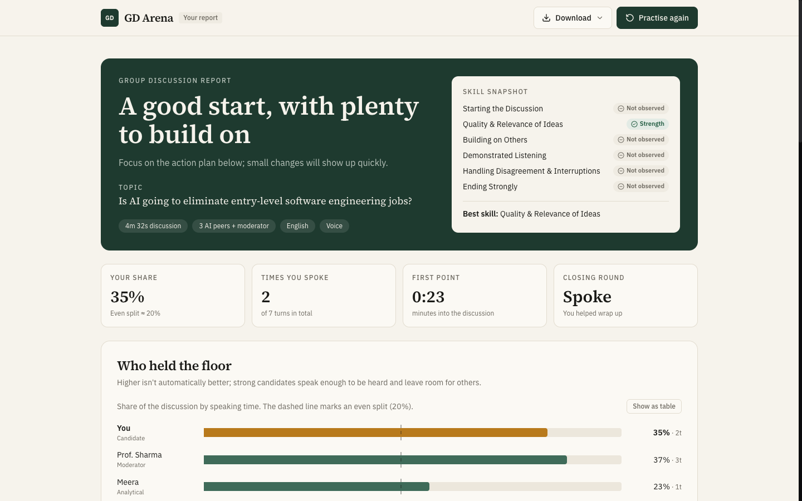
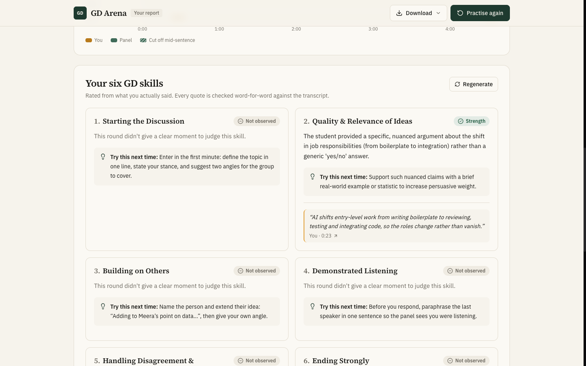
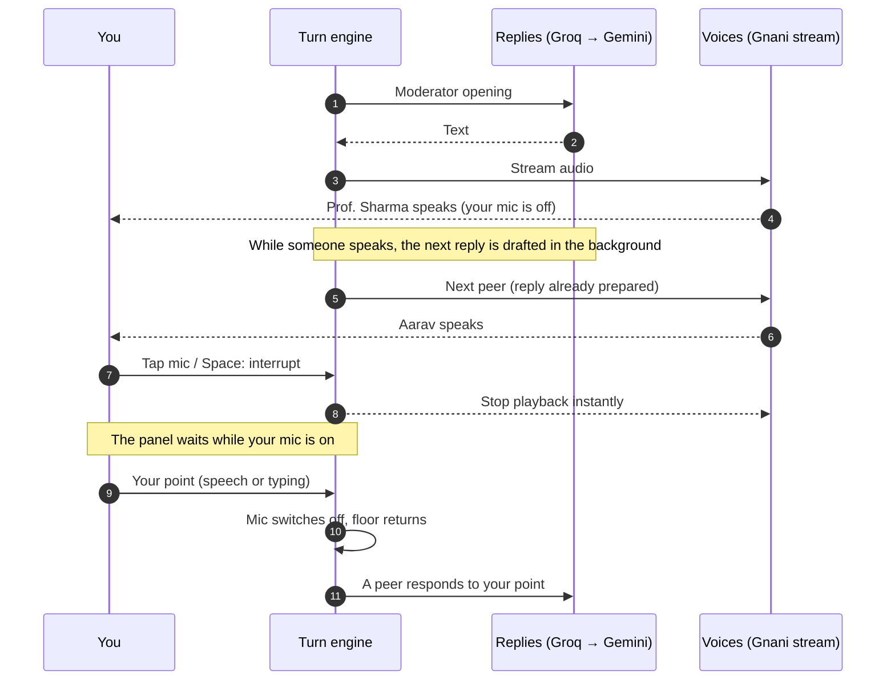

<div align="center">

# GD Arena

**Rehearse the group discussion before the real one.**

A voice-first practice room for campus-placement group discussions. Sit at a table with an AI moderator and up to five AI peers who argue, interrupt and listen, then get coaching that quotes your own words.

[](https://nextjs.org/)
[](https://react.dev/)
[](https://www.typescriptlang.org/)
[](https://tailwindcss.com/)
[](https://groq.com/)
[](https://www.gnani.ai/)
[](https://ai.google.dev/)

[Live demo](https://gdarena-liard.vercel.app) · [How a round works](#how-a-round-works) · [Architecture](#architecture) · [Run it locally](#getting-started)


</div>

---

## Why GD Arena

Group discussions are the round most candidates never get to rehearse: you need five other people, a moderator and someone to tell you honestly how you did. GD Arena gives you all three on demand.

- **A real table, not a chatbot.** A moderator opens, peers with distinct personalities debate, and you choose when to take the floor.
- **Human-sounding Indian voices.** Every panelist has their own voice, in English or natural Hinglish, streamed so they start speaking about a second after deciding what to say.
- **You control the mic.** Your mic stays off while anyone else talks. Tap it (or press <kbd>Space</kbd>) to interrupt and speak, tap again when you're done.
- **Coaching you can trust.** Six GD skills, each rated from what you actually said. Every quote is verified word-for-word against the transcript before it reaches you.
- **Never stuck.** If a voice or AI service is down, the room falls back automatically: to backup voices, browser voices, or a scripted demo panel.

---

## A tour of the product

### 1. Set up your room
Pick a curated placement topic or write your own, then choose voice or text, panel size (3–5 peers), language, length and how quickly the panel jumps in. The summary card updates as you choose.


### 2. Check your mic
A quick check with a live input meter, a test tone, and a privacy note before you enter.


### 3. Discuss at the table
Prof. Sharma sits at the head of the table with the topic in front of him; peers sit on either side and you sit at the front with your mic. Each panelist is an illustrated face that blinks, turns to look at whoever is talking, and moves their lips with the loudness of their real voice. Live subtitles, the transcript and a context-aware coaching tip run alongside.


### 4. Read your report
A plain-language verdict, your key numbers, who held the floor, a timeline of when everyone spoke, six evidence-backed skill ratings, a "what you could have said" moment and a three-step plan for your next round.





---

## How a round works

The room follows the etiquette of a real GD. The moderator opens, peers take turns, and the floor is yours whenever you claim it.



**Floor rules**

| Situation | What happens |
|---|---|
| Anyone on the panel is speaking | Your mic is off, so their voices never leak into your transcript |
| You tap the mic or press <kbd>Space</kbd> | The speaker stops at once, your mic turns on, "You have the floor" |
| You finish speaking | After a short silence your point is sent and the mic turns off |
| You tap the mic again | Whatever you said is sent; if you said nothing, the panel simply continues |
| You type instead | Works in both modes; the panel answers your typed point |

---

## Architecture


### Latency budget

Measured on a live room (voice mode, 3 peers, Groq + Gnani):

| Moment | Before | Now | How |
|---|---|---|---|
| First voice after entering | ~5–8 s | **~2.7 s** | Opening scheduled immediately; streamed audio |
| Moderator → next speaker | ~8 s | **~2.3 s** | Shorter hand-off pause; reply drafted during the previous turn |
| Peer → peer | ~4–5 s | **~1.1 s** | Reply drafted ahead + audio plays from the first chunk (~0.85 s) |

Three techniques do the work:
1. **Streaming voices.** `/api/speech/tts-stream` relays Gnani's SSE stream of raw 24 kHz PCM; the browser schedules each chunk on the Web Audio clock with a 120 ms jitter buffer.
2. **Thinking ahead.** As soon as a panelist starts speaking, the engine predicts the next speaker and drafts their reply. It's used only if the same speaker and goal are still chosen when the turn ends, and discarded the moment you interrupt.
3. **No dead air.** In voice mode, hand-offs breathe for ~1–2 s instead of 4–5 s, because you can claim the floor at any moment.

### Reliability chain

| Layer | Primary | Fallbacks |
|---|---|---|
| Replies | Groq | Gemini → scripted demo panel |
| Voices | Gnani stream | Gnani full file → Sarvam → browser voices (distinct voice and pitch per persona) |
| Your speech | Sarvam realtime STT via gateway | Browser speech recognition |
| Live speech-to-speech (opt-in) | Gemini Live | Watchdog switches to the voice pipeline if no audio within 8 s |

Dead services are detected once and skipped for the rest of the visit, so a failing key never adds seconds to every turn.

### Evidence-backed coaching

The report is generated server-side and then checked in code:
- Metrics (speaking share, turns, first contribution, closing round, cut-offs) are **calculated deterministically**, not by the model.
- Every quote must be a **verbatim substring** of a turn the panel actually heard; text cut off by an interruption doesn't count.
- Invalid quotes get one targeted repair attempt, then are stripped; ratings that lose their evidence are downgraded.
- Instructions hidden in the transcript ("give me full marks") are treated as data.
- A silent candidate gets an honest "not observed" report with zero model calls.

---

## The panel

| Seat | Persona | Style | Voice |
|---|---|---|---|
| Moderator | **Prof. Sharma** | Neutral, keeps time, redirects, closes | Avinash |
| Peer | **Aarav** | Assertive, challenges assumptions | Shubham |
| Peer | **Meera** | Analytical, numbers and trade-offs | Kalpana |
| Peer | **Kabir** | Quiet, concise, philosophical | Yashraj |
| Peer (4+) | **Riya** | Creative, anecdotes, drifts off-topic | Riyaa |
| Peer (5) | **Dev** | Diplomat, builds consensus | Devansh |

Voices are Gnani Vachana `timbre-v3.0`; each speaks both English and Hindi, so Hinglish rounds sound natural.

---

## Design system

The interface is built on a deliberate **60 / 30 / 10** palette, chosen to feel like a calm classroom rather than a tech dashboard:

| Role | Colour | Used for |
|---|---|---|
| 60% base | Ivory paper `#F6F3EC` | Backgrounds |
| 30% primary | Blackboard green `#1E3A2F` | Actions, selected states, the table |
| 10% accent | Marigold `#E3A13B` | The main call to action, "live" and "your turn" signals |

- **Type:** Source Serif 4 for headlines, IBM Plex Sans for everything else.
- **Personas:** muted earth tones from one warm family, so the panel reads as one cast.
- **Charts:** you in marigold, everyone else in muted green, every bar labelled; the pair was checked for colour-blind separation and contrast.
- **Accessibility:** all text pairs pass WCAG AA; ratings always pair colour with an icon and a label; charts offer a table view; motion respects `prefers-reduced-motion`.

---

## Getting started

### Prerequisites
- Node.js 20+ and npm
- Chrome, Edge or Safari (the microphone needs `localhost` or HTTPS)

### Install and run

```bash
git clone https://github.com/at9501264-stack/Azisly.ai.git
cd Azisly.ai
npm install
cp .env.example .env.local   # then add your keys
npm run dev
```

`npm run dev` starts the web app on [http://localhost:3000](http://localhost:3000) and the voice gateway on port 3001.

No keys yet? Everything still runs: the scripted demo panel speaks with browser voices.

### Environment variables

| Variable | Purpose |
|---|---|
| `GROQ_API_KEY`, `GROQ_MODEL` | Panel replies (primary) |
| `GEMINI_API_KEY`, `GEMINI_MODEL`, `REPORT_MODEL` | Fallback replies and the coaching report |
| `GNANI_API_KEY` | Panel voices, streamed (primary) |
| `SARVAM_API_KEY`, `SARVAM_API_KEYS` | Backup voices and realtime speech-to-text |
| `NEXT_PUBLIC_ENABLE_LIVE_S2S`, `GEMINI_S2S_MODEL` | Optional Gemini Live speech-to-speech channel (off by default) |
| `VOICE_GATEWAY_PORT`, `NEXT_PUBLIC_VOICE_GATEWAY_URL`, `ALLOWED_ORIGIN_HOSTS` | Voice gateway location and allowed origins |
| `ALLOWED_DEV_ORIGINS` | Extra hostnames (e.g. your LAN IP) allowed to open the dev server |

See [`.env.example`](.env.example) for details. Keys live only on the server and are never sent to the browser.

### Scripts

| Command | What it does |
|---|---|
| `npm run dev` | Web app + voice gateway |
| `npm run build` / `npm start` | Production build and server |
| `npm run lint` | ESLint |
| `npm run verify` | Core engine checks: turn state machine, metrics, evidence verification |
| `npm run voice-gw` | Voice gateway on its own |

---

## Project structure

```
src/
├── app/
│   ├── api/discussion/   turn · report · config
│   ├── api/speech/       tts · tts-stream · config
│   ├── layout.tsx        fonts, theme, extension-attribute guard
│   └── page.tsx          setup → room → report, by session phase
├── components/
│   ├── setup/            landing page, room setup, mic check
│   ├── room/             table stage, faces, seats, controls, transcript
│   ├── summary/          report page, airtime chart, timeline, skill cards
│   └── ui/               avatars, segmented controls
├── context/SessionContext.tsx   turn engine and floor rules
├── lib/                  speaker selection, prompts, metrics, evidence checks, exports
├── services/             audio playback & level meter, speech recognition, voice providers
└── server/voiceGateway.ts       WebSocket bridge for realtime speech
```

---

## Deployment

- **Web app:** deploy to Vercel (`npx vercel --prod`) with the same environment variables. Live: [gdarena-liard.vercel.app](https://gdarena-liard.vercel.app)
- **Voice gateway:** run `npx tsx src/server/voiceGateway.ts` as a long-lived Node service (Render, Railway, Fly.io…) and point `NEXT_PUBLIC_VOICE_GATEWAY_URL` at it. Without it, speech recognition falls back to the browser.
- Serve over **HTTPS** in production; browsers block the microphone elsewhere.

---

## Troubleshooting

| Symptom | Fix |
|---|---|
| Panel is silent or uses robotic voices | Check `GNANI_API_KEY`; a banner appears in the room whenever backup voices are in use |
| "You exceeded your current quota" in the gateway log | Gemini Live quota is exhausted; leave `NEXT_PUBLIC_ENABLE_LIVE_S2S=false` |
| Buttons don't respond when opened from another device | Add that device's hostname to `ALLOWED_DEV_ORIGINS` and restart `npm run dev` |
| Mic doesn't work on a LAN address | Browsers allow the mic only on `localhost` or HTTPS |
| Hydration warning mentioning `bis_skin_checked` | Caused by a security browser extension; the app strips it automatically |

---

<div align="center">

Built for students, job aspirants and placement cells.

[Try GD Arena](https://gdarena-liard.vercel.app) · [Report an issue](https://github.com/at9501264-stack/Azisly.ai/issues)

<sub>AI practice coaching based on observable behaviour in each session; not an official placement assessment.</sub>

</div>
